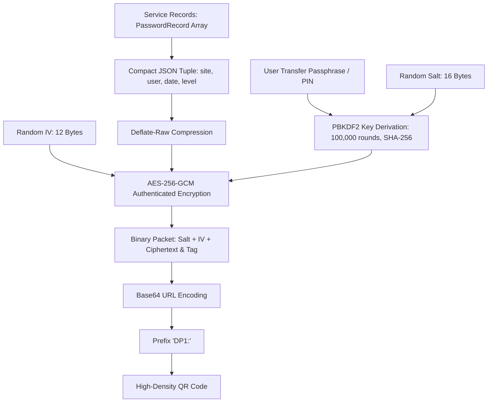

# DeterminaPass QR Code Sync Protocol Specification (DP1)

## 1. Overview
The **DP1 (DeterminaPass v1)** QR Sync Protocol enables secure, offline, cross-platform transfer of service metadata between devices (e.g., Desktop Browser <-> Mobile Phone) without relying on intermediate servers, Bluetooth, or local network pairing.

To ensure **zero-leakage** against cameras, visual eavesdroppers, and QR scanners, the payload enforces:
1. **Minimal Payload Surface:** Only essential tuples `[site, user, created, level]` are encoded. Mnemonic passwords and raw secret values are NEVER transmitted.
2. **Deflate-Raw Compression:** Payload JSON is compressed using native Deflate compression, reducing payload volume by up to 60-70%.
3. **Authenticated Cryptography (AES-256-GCM):** Data is encrypted with a 256-bit AES key derived via PBKDF2 (100,000 iterations of SHA-256 with a unique 16-byte cryptographic salt).
4. **Binary Wire Format:** A compact binary packet containing `[16-byte Salt] + [12-byte IV] + [Ciphertext + 16-byte GCM Tag]`, encoded as URL-safe Base64 prefixed by `DP1:`.

---

## 2. Cryptographic and Compression Pipeline

### ASCII Representation
```text
  +----------------------+
  |  Service Records     |
  +----------+-----------+
             |
             v
  +----------------------+
  |  Compact JSON Array  |  --> [ ["github.com", "user@mail.com", "2026-10-30", 2] ]
  +----------+-----------+
             |
             v
  +----------------------+
  | Deflate Compression  |  --> Compressed Raw Bytes (~60% size reduction)
  +----------+-----------+
             |
             v
  +----------------------+
  |  AES-256-GCM Encrypt |  <-- Key derived via PBKDF2(Passphrase, Salt, 100k, SHA-256)
  +----------+-----------+
             |
             v
  +----------------------+
  | Binary Packet Wrap   |  --> [Salt: 16B] + [IV: 12B] + [Ciphertext: NB]
  +----------+-----------+
             |
             v
  +----------------------+
  | Base64 + 'DP1:'      |  --> "DP1:V2hhdEFuQXdlc29tZUV4YW1wbGU..."
  +----------+-----------+
             |
             v
  +----------------------+
  |     QR Code Matrix   |  --> Rendered to Screen / Scanned by Camera
  +----------------------+
```

### Mermaid Diagram


---

## 3. Wire Format Specification
| Offset | Field | Length | Description |
|---|---|---|---|
| 0 | Protocol Prefix | 4 Bytes (text) | `DP1:` identifier |
| 4 | Salt | 16 Bytes (binary) | Random cryptographic salt for PBKDF2 |
| 20 | IV / Nonce | 12 Bytes (binary) | Unique initialization vector for AES-GCM |
| 32 | Ciphertext + Tag | Variable (min 16 Bytes) | Deflate-compressed ciphertext + 128-bit authentication tag |

---

## 4. Security & Interoperability Invariants
1. **Eavesdropper Resistance:** Without knowing the Transfer Passphrase / PIN, an adversary capturing or photographing the QR code sees only uniformly random cryptographic noise.
2. **Tamper Proofing:** Modifying any bit of the QR code causes AES-GCM tag verification to immediately fail during decryption.
3. **Cross-Platform Compatibility:** The protocol is symmetrically implemented in TypeScript (`QrSyncService`) and Kotlin Multiplatform (`QrSync.kt`).
